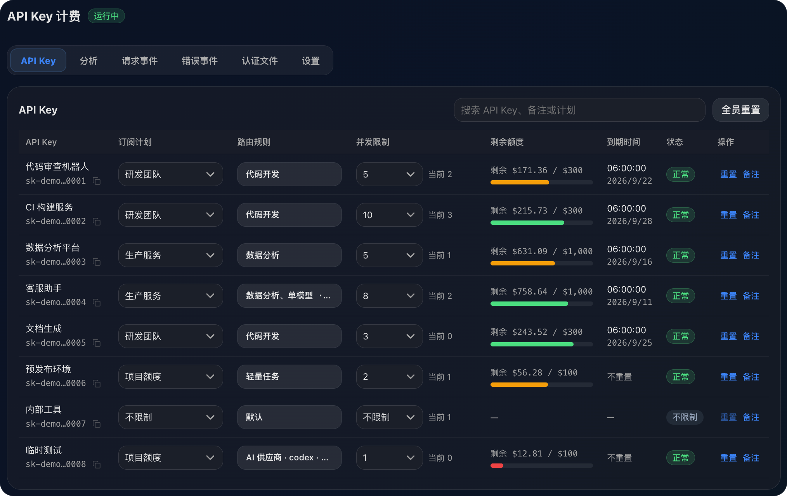
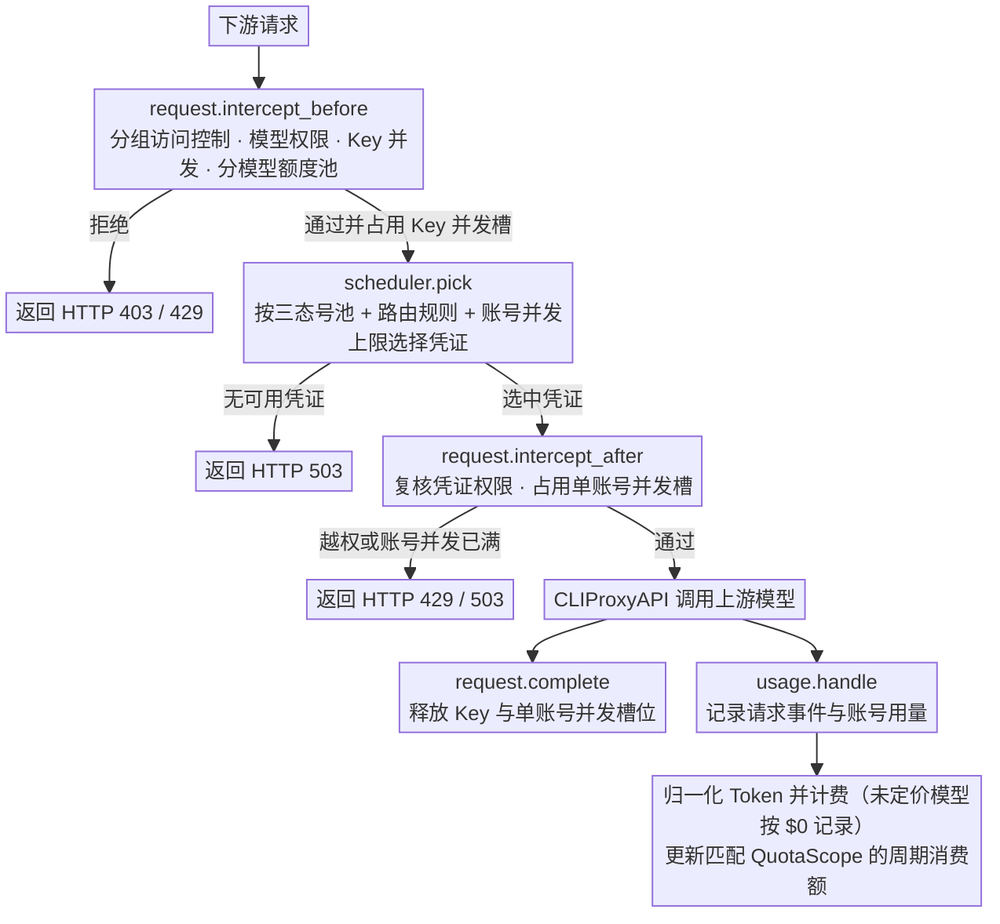

<div align="center">
  <h1>CPA Key Manager (cpa-key-billing)</h1>
  <p><strong><a href="https://github.com/router-for-me/CLIProxyAPI">CLIProxyAPI</a> 下游 API Key 计费、团队分组三态号池、分模型订阅额度与单账号并发管理插件。</strong></p>
  <p>
    <a href="https://github.com/hbdzp/CPA-Key-Manager/releases/latest"></a>
    <a href="https://github.com/hbdzp/CPA-Key-Manager/actions/workflows/check.yml"></a>
    
    <a href="./LICENSE"></a>
  </p>
  <p><a href="./README.en.md">English</a> · <strong>简体中文</strong></p>
</div>


## 功能特性

- **多维订阅额度与分模型额度池（`QuotaScope`）**
  - 支持金额（USD）、Token、请求数三种额度，可按 API Key 独立计时或按订阅计划统一周期重置。
  - 同一订阅计划内可创建多个额度窗口，并按**全部模型**、**模型家族**（`Claude` / `GPT` / `Gemini` / `DeepSeek` / `Qwen` / `Grok` / `Kimi` / `GLM`）或**自定义规则**（精确模型名与 `prefix*` 通配符）划分独立额度池，配置抽屉支持实时预览匹配与排除模型。
- **团队分组与三态号池（`ordinary` / `exclusive` / `common`）**
  - **普通分组（`ordinary`）**：标准团队权限分组，支持绑定路由规则或直接配置模型/凭证黑白名单，组间凭证可共享。
  - **独占分组（`exclusive`）**：组内绑定的上游凭证或凭证类别对该分组**独占隔离**，保存时自动校验跨组冲突，其他分组与未分组 Key 均无法调度独占池内的凭证。
  - **公共分组（`common`）**：作为所有已分组 API Key 的公共兜底补充池，无需逐个绑定 API Key。
  - **访问控制双开关**：支持「启用分组与路由访问控制」总开关与「拒绝未分组 API Key 请求（`deny_ungrouped`）」开关；支持单个分组一键启用/停用。
  - **组内直管上游账号**：分组卡片内可直接展开查看关联的上游账号运行态、活跃并发，并支持一键全局启用/禁用上游账号。
- **精细路由控制与记忆化已选置顶 UI**
  - 支持在路由规则、团队分组、API Key 三个层级通过**三态选择器**（未选 / 允许 `✓` / 拒绝 `✕`）配置模型、整类凭证与单个凭证权限。
  - 支持按渠道类别与启用状态二级筛选、当前筛选结果局部批量允许/拒绝/清空，以及**打开编辑抽屉时自动将已选条目固定置顶**（编辑过程中切换状态不跳位）。
  - **凭证轮换无感迁移**：当上游 OAuth 认证文件刷新或重登产生新凭证 ID 时，自动将路由规则、团队分组与 API Key 绑定中的旧凭证指纹平滑迁移至新凭证。
- **上游单账号并发限制与账号用量统计**
  - 支持设置**全局默认单账号并发上限**（0～1000）及**单账号独立并发上限**（0～1000），`0` 表示不限制。
  - **双重并发防线**：在 `scheduler.pick` 调度阶段自动优先避让并发已满的候选账号；在 `request.intercept_after` 阶段复核路由权限并原子占用账号并发槽，请求完成时自动释放。
  - 「认证文件」页内置「单账号并发控制」与「账号用量与并发」双统计卡片，实时展示各账号请求数、成功/失败数、Token 用量、累计费用与活跃并发。
- **灵活定价与未定价模型 `$0` 自动放行**
  - 支持从 [models.dev](https://models.dev/) 自动同步参考价、自定义价格覆盖、按输入 Token 阈值切换**长上下文阶梯计价**，以及 Codex Priority 请求 2.5× 计费。
  - **未定价模型 `$0` 放行**：未配置自定义价格且不在参考价目表中的模型自动按 `$0`（`unpriced`）放行并正常统计 Token 与请求次数，不再返回 `503 model_price_error` 阻断调用。
- **API Key 自助查询页（`#account`）**
  - 下游用户可使用自己的 API Key 查看订阅窗口进度、分模型额度池范围、可用模型列表、部分限流状态（`partially_blocked`）及请求明细，支持可选的邮箱脱敏与认证文件额度自助重置。

## 工作原理

插件在请求到达上游前检查分组与访问控制、模型权限、API Key 并发和分模型订阅额度；在调度阶段结合三态号池（普通/独占/公共）与单账号并发上限挑选可用凭证；在认证选定后复核凭证权限并占用单账号并发槽。调用结束后，CLIProxyAPI 通过 `usage.handle` 上报用量，插件据此记录请求事件、计算费用并更新匹配的周期额度窗口。



## 环境要求

- CLIProxyAPI `7.3.7` 或更高版本，建议使用最新版本
- 使用支持插件的 CLIProxyAPI 构建，不要使用 `no-plugin` 版本

## 安装

### 脚本一键安装

在 CLIProxyAPI 根目录运行。macOS 和 Linux 使用：

```sh
curl -LsSf https://raw.githubusercontent.com/hbdzp/CPA-Key-Manager/main/install.sh | sh
```

Windows 请先停止 CLIProxyAPI，再在 PowerShell 中运行：

```powershell
irm https://raw.githubusercontent.com/hbdzp/CPA-Key-Manager/main/install.ps1 | iex
```

安装脚本会将插件安装到当前目录的 `plugins/`。安装或升级完成后需要重启 CLIProxyAPI。

### 手动安装 / 预编译产物

可直接从本仓库 `dist/` 目录或 [Releases](https://github.com/hbdzp/CPA-Key-Manager/releases/latest) 获取对应平台的动态库，放入 CLIProxyAPI 的 `plugins/` 目录：

```text
plugins/cpa-key-billing.so       # Linux (amd64 / arm64)
plugins/cpa-key-billing.dylib    # macOS (amd64 / arm64)
plugins/cpa-key-billing.dll      # Windows (amd64 / arm64)
```

### 从源码编译

需要 Go `1.24+` 并开启 `CGO_ENABLED=1` 及 `-tags cshared -buildmode=c-shared`：

```sh
# Linux (amd64)
CGO_ENABLED=1 GOOS=linux GOARCH=amd64 \
  go build -buildvcs=false -trimpath -ldflags="-s -w -buildid=" \
  -tags cshared -buildmode=c-shared \
  -o dist/cpa-key-billing.so ./cmd/cpa-key-billing

# macOS (arm64 / amd64)
CGO_ENABLED=1 GOOS=darwin GOARCH=arm64 \
  go build -buildvcs=false -tags cshared -buildmode=c-shared \
  -o dist/cpa-key-billing.dylib ./cmd/cpa-key-billing

# Windows (amd64)
CGO_ENABLED=1 GOOS=windows GOARCH=amd64 CC=x86_64-w64-mingw32-gcc \
  go build -buildvcs=false -trimpath -ldflags="-s -w -buildid=" \
  -tags cshared -buildmode=c-shared \
  -o dist/cpa-key-billing.dll ./cmd/cpa-key-billing
```

## 配置说明

在 CLIProxyAPI 配置文件 `config.yaml` 中加入：

```yaml
plugins:
  enabled: true
  dir: "plugins"
  configs:
    cpa-key-billing:
      enabled: true
      priority: 100 # 插件调度优先级，数值越大越优先
      debug: false # 是否记录 debug 日志，例如路由日志、匹配参考价日志
      codex_fast_mode_billing: false # 开启后，Codex 的 priority 请求按 2.5 倍计费
      mask_api_key_view_emails: false # 对 API Key 查询页面返回的邮箱进行掩码脱敏
      allow_api_key_quota_reset: false # 允许 API Key 用户重置可访问的 Codex 和 Claude 认证文件额度，消耗上游重置次数
      state_file: "plugins/cpa-key-billing-state-v1.db"
      routing:
        strategy: "round-robin" # round-robin、weighted-round-robin、fill-first
        session-affinity: false # 同一会话优先复用可用的上游凭证
        session-affinity-ttl: "1h" # 会话绑定的空闲过期时间
```

> [!WARNING]
> 升级前请备份数据文件。
>
> - `v1.0.0` 至最新版本的 SQLite 数据库文件（Schema `v10`～`v20`）支持启动时自动无损迁移。
> - 单账号并发上限配置保存在 `state_file` 同目录的 `.account-runtime.json` 中。

## 页面访问

管理员可以从 CLIProxyAPI 管理中心的「API Key Billing」菜单进入，也可以直接打开：

```text
http(s)://<CLIProxyAPI 地址>/v0/resource/plugins/cpa-key-billing/ui
```

普通用户使用自己的 API Key 查询订阅额度和用量时，直接打开：

```text
http(s)://<CLIProxyAPI 地址>/v0/resource/plugins/cpa-key-billing/ui#account
```

## 团队分组、三态号池与路由规则

1. **三态号池模式**：
   - **普通分组（`ordinary`）**：组内路由与权限对所属 API Key 生效，允许与其他普通分组共享相同凭证。
   - **独占分组（`exclusive`）**：组内声明的凭证/凭证类别仅限本组 API Key 使用，自动从其他分组和未分组 Key 的可用池中剔除；不同独占组之间或独占组与公共组之间不允许配置重叠凭证。
   - **公共分组（`common`）**：所有已加入至少一个启用分组的 API Key，自动合并启用中的公共分组模型与凭证权限（仍排除其他独占组的私有凭证）。
2. **权限合并规则**：
   - 在路由规则、团队分组、API Key 页面均可使用三态选择框（未选 / 白名单勾号 `✓` / 黑名单叉号 `✕`）。
   - 模型与凭证分别合并有效规则：白名单取并集，黑名单取并集，黑名单优先；白名单为空时允许全部非独占资源，再排除黑名单。

## 拦截请求的响应

| 场景 | 状态码 | `type` | `code` |
| --- | --- | --- | --- |
| API Key 并发已满 | `429` | `rate_limit_error` | `rate_limit_exceeded` |
| 上游单账号并发已满 | `429` | `rate_limit_error` | `rate_limit_exceeded` |
| 订阅额度窗口（含分模型额度池）用尽 | `429` | `rate_limit_error` | `rate_limit_exceeded` |
| 未分组 API Key 被拦截 / 所属分组全部停用 | `403` | `permission_error` | `access_denied` |
| 模型无权访问 | `403` | `permission_error` | `insufficient_quota` |
| 没有符合规则且可用的凭证 | `503` | `server_error` | `internal_server_error` |
| 选中的凭证不符合路由或独占池规则 | `503` | `server_error` | `routing_credential_mismatch` |
| 无法校验所选凭证的路由权限 | `503` | `server_error` | `routing_credential_unverified` |
| 已绑定的路由规则或独占池配置冲突 | `503` | `server_error` | `routing_configuration_error` |

## 致谢

- 上游基座：[haowang02/cpa-plugin-key-billing](https://github.com/haowang02/cpa-plugin-key-billing)
- 特性参考：[CHIMOOO/cpa-plugin-key-billing-manager](https://github.com/CHIMOOO/cpa-plugin-key-billing-manager)
- [LINUX DO](https://linux.do/) - 新的理想型社区
